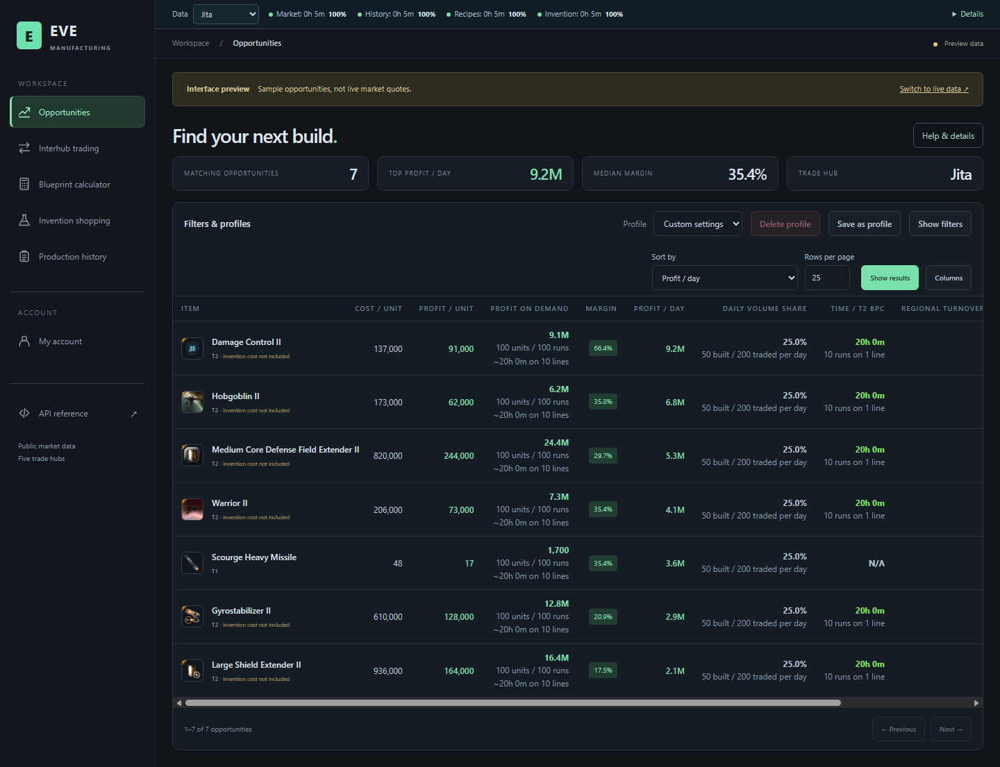
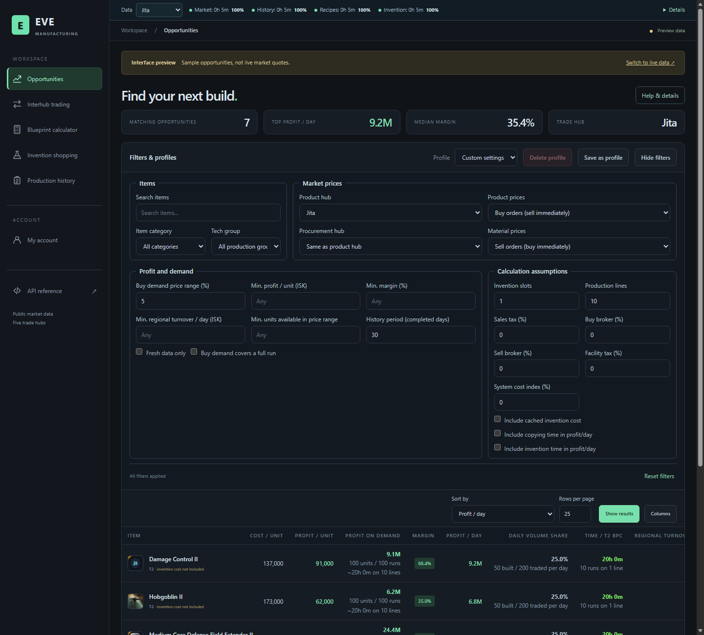
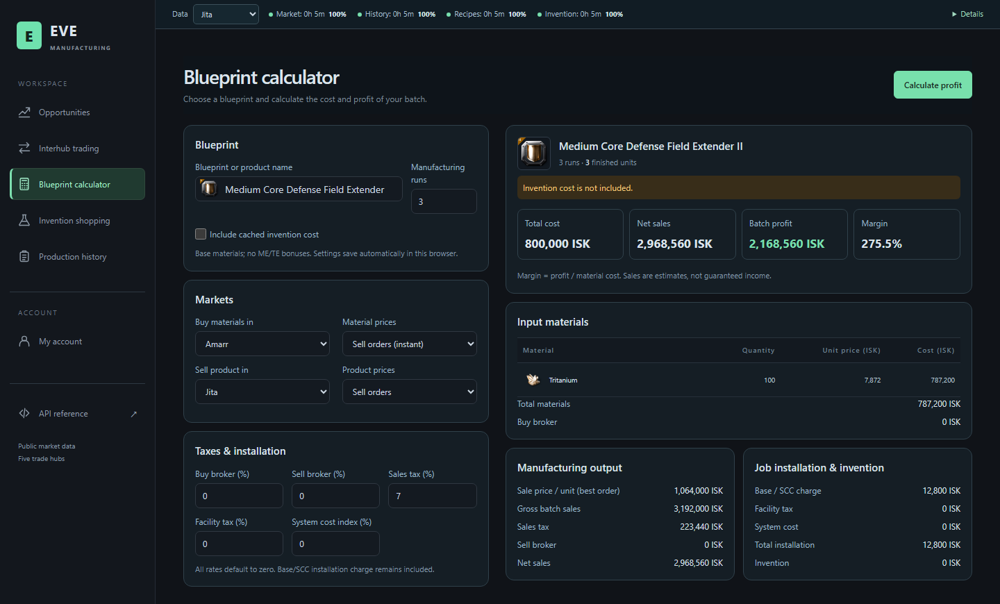
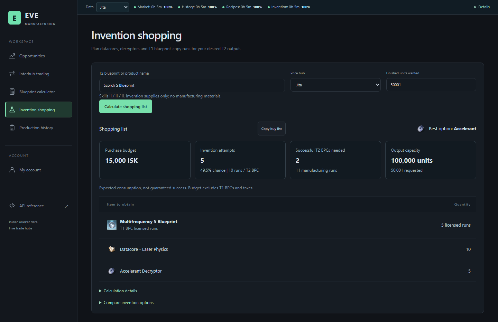
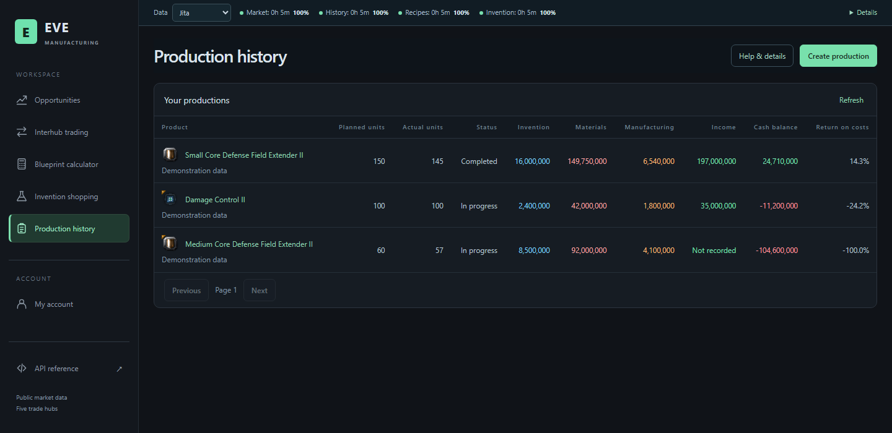
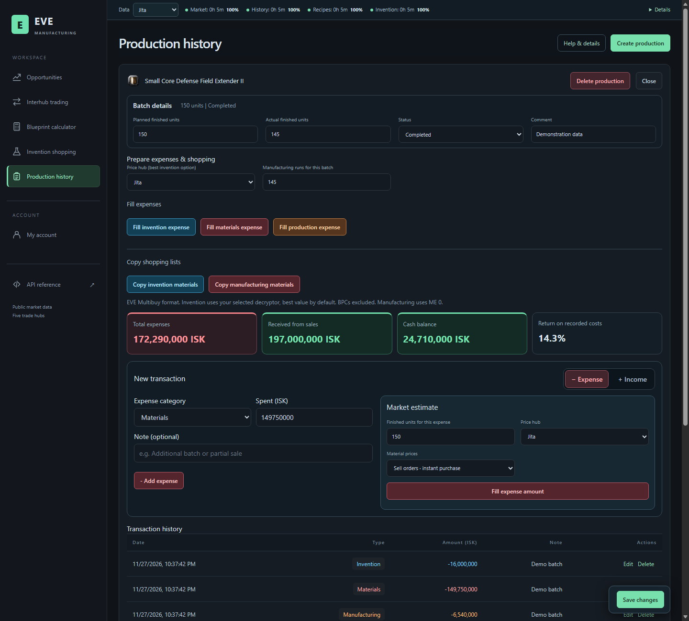
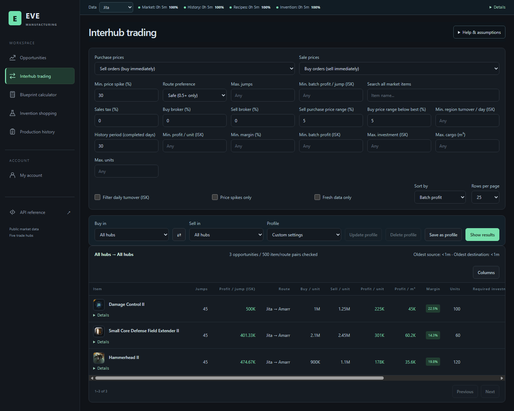

# EVE Manufactoring Helper

A web app for planning manufacturing in EVE Online. Compare profitability and market demand
across five trade hubs, calculate invention shopping lists, and track personal production
expenses and income from partial sales. Uses public ESI and EVE Ref data; no EVE API keys needed.

## Run

Requires Docker with Docker Compose.

1. Copy `.env.example` to `.env` and configure the database and Redis credentials:

   ```bash
   cp .env.example .env
   ```

   On Windows PowerShell, use `Copy-Item .env.example .env` instead.

2. Build and start the project:

   ```bash
   docker compose up -d --build --wait
   ```

3. Create the first administrator and enter a password of at least 12 characters when prompted:

   ```bash
   docker compose exec api python -m app.domains.accounts.manage --username admin
   ```

4. Open [localhost:8000](http://localhost:8000) and log in. Administrators create additional
   accounts at `/admin`.

Market data loads in the background; initial results may take time to appear.
The port can be changed with `APP_PORT`. Database and cache data persist in Docker volumes.

To rebuild after code changes, run `docker compose up -d --build --wait` again.

## Tools and libraries

- **Backend:** Python 3.12, FastAPI, Uvicorn.
- **Database:** PostgreSQL, SQLAlchemy async, asyncpg, Alembic migrations.
- **Validation and configuration:** Pydantic, pydantic-settings.
- **Dependency injection:** Dishka.
- **Background jobs and cache:** ARQ, Redis.
- **HTTP integrations:** HTTPX for public ESI and EVE Ref APIs.
- **Frontend:** Jinja2 templates, Alpine.js, JavaScript, CSS.
- **Optimization:** SciPy (used by the currently disabled cargo-planning prototype).
- **Testing:** pytest, pytest-asyncio, pytest-cov, respx, fakeredis, aiosqlite,
  testcontainers.
- **Code checks:** Ruff, mypy, djLint, jsbeautifier, cssbeautifier.
- **Deployment:** Docker, Docker Compose.

## Architecture

The application is a modular monolith. Domain modules separate HTTP routes, business services
and repository interfaces. Dishka assembles dependencies; services manage transactions through
Unit of Work. ARQ workers refresh external data in the background, while requests use saved
market snapshots and cached calculations. The frontend uses server-rendered Jinja2 templates
with Alpine.js for interaction.

## Demo

Screenshots use illustrative sample data, including test production records. Prices, profits and
market freshness shown here are examples, not live quotes. Production records belong to the demo
only; no personal account data is included.

### Opportunities

Compare manufacturing candidates, demand, margins and production time.



<details>
<summary>Filters and calculation settings</summary>



</details>

### Blueprint calculator



### Invention shopping



### Production history



<details>
<summary>Batch details, expense preparation and material shopping</summary>



</details>

### Interhub trading


